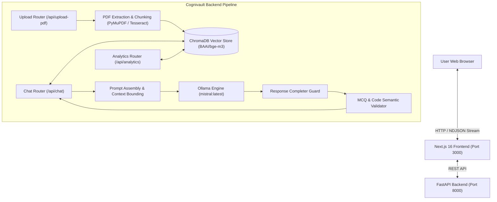

# Cognivault

> **Document-grounded question answering, verification, and automated question generation powered by local LLMs.**

Cognivault is a Retrieval-Augmented Generation (RAG) platform designed to let users upload complex technical documents (such as textbooks, question banks, and lecture notes) and interact with them through document-grounded question answering, document boundary filtering, and semantic evaluation.

Unlike generic chat interfaces that produce plausible-sounding answers or summarize broad pre-training data, Cognivault applies document-level metadata filtering, validates code output semantics against targeted rules, and provides automated multiple-choice question (MCQ) generation.

---

## Problem Statement & Intended Users

### The Problem
Traditional large language model assistants often suffer from hallucination, out-of-domain drift, and a lack of grounding when answering questions from technical documents. When tasked with generating assessment materials (like multiple-choice questions with code snippets), generic LLMs frequently generate invalid code, select incorrect answers, or provide circular explanations that repeat the chosen option rather than explaining *why* it is correct.

### Who Cognivault Is For
- **Students & Self-Learners**: Interrogate textbooks, lecture slides, and question banks with document-grounded citations.
- **Educators & Exam Authors**: Generate MCQs directly from source materials with automated checks for code output, option validity, and technical explanations.
- **RAG Researchers & Developers**: Explore a practical implementation of local embedding models, vector stores, prompt-budget management, and semantic response completion.

---

## Features

### Currently Implemented Features
- **Document-Grounded Q&A**: Answers are retrieved from ChromaDB vector chunks, with prompt guards designed to refuse out-of-scope questions without explicit user permission.
- **Document Boundary Filtering**: Vector queries are filtered by the active `document_id` metadata to isolate retrieval to the selected document.
- **Automated MCQ Generation & Multi-Tier Validation**:
  - **Code Snippet Checks**: Flags or rejects code-dependent questions that omit the referenced code snippet.
  - **Java Semantic Evaluation**: Validates loop execution, array index bounds (1D vs 2D ragged/rectangular arrays), max/min algorithms, and String immutability.
  - **Explanation Fallacy Detection**: Rejects fallacies (such as claiming `implements` defines an interface or providing circular reasoning) and improves the technical explanation.
  - **Inheritance Hierarchy Grounding**: Checks class and interface relationships against the source document chunks before returning questions.
- **Document Overview Generation**: Summarizes documents into concise, grounded overviews without hallucinating ungrounded question counts.
- **Combined Overview & MCQ Routing**: Handles combined requests (e.g., *"Summarize the document, then generate 3 MCQs"*) in a single coordinated pipeline.
- **Resilient Streaming & Response Continuation**: Real-time NDJSON streaming with automatic detection and completion of mid-sentence truncations.
- **Modern Web Interface**: Responsive dark-themed UI built with Next.js 16 (App Router), React 19, and Tailwind CSS.

### Planned Architecture (In Progress / Roadmap)
- **Agentic Multi-Agent Orchestration**: Query decomposition, multi-step search planning, and autonomous self-reflection loops.
- **Cross-Document Comparative Analysis**: Synthesizing answers across multiple uploaded documents simultaneously.
- **Semantic Caching**: In-memory vector caching for frequently asked questions to minimize local LLM compute.
- **Persistent User Accounts**: Multi-user session management and cloud-synced document collections.

---

## Architecture Overview



---

## Technology Stack

| Layer | Technology | Purpose |
| :--- | :--- | :--- |
| **Backend Framework** | [FastAPI](https://fastapi.tiangolo.com/) + [Uvicorn](https://www.uvicorn.org/) | High-performance asynchronous REST API and streaming endpoints |
| **LLM Inference** | [Ollama](https://ollama.com/) (`mistral:latest`) | Local CPU/GPU large language model execution |
| **Embeddings** | [HuggingFace](https://huggingface.co/) (`BAAI/bge-m3`) | Dense vector representations for semantic document retrieval |
| **Vector Database** | [ChromaDB](https://www.trychroma.com/) | Local persistent vector storage with metadata filtering |
| **Document Parsing** | [PyMuPDF](https://pymupdf.readthedocs.io/) (`fitz`) + [Tesseract OCR](https://github.com/tesseract-ocr/tesseract) | Text extraction from digital and scanned PDFs |
| **Frontend Framework**| [Next.js 16](https://nextjs.org/) (App Router) + [React 19](https://react.dev/) | Client interface, streaming token renderer, and document manager |
| **Styling** | [Tailwind CSS v4](https://tailwindcss.com/) + [Lucide Icons](https://lucide.dev/) | Clean dark-mode UI and icon system |

---

## Prerequisites

Before setting up Cognivault locally, ensure you have installed:

1. **Operating System**: Windows 10/11 (macOS and Linux also supported).
2. **Python**: Version 3.10 or higher (`python --version`).
3. **Node.js**: Version `20.9.0` or higher (`node --version`) and `npm` (required by Next.js 16).
4. **Ollama**:
   - Download and install from [ollama.com](https://ollama.com/).
   - **Check if Ollama is already running**:
     On Windows, Ollama typically starts automatically as a background system tray application upon login. Verify whether it is already active:
     ```powershell
     ollama list
     ```
     (You can also check for the Ollama icon in the Windows Taskbar Notification Area / System Tray, or open `http://127.0.0.1:11434` in your browser to verify it displays *"Ollama is running"*).
   - **Start only if not running**:
     If `ollama list` fails with a connection error:
     - On Windows: Launch the **Ollama** application from your Start Menu.
     - On headless Linux/server environments: Run `ollama serve`. (Do not run `ollama serve` if Ollama is already running, as it will error with `bind: address already in use`).
   - **Pull the default model**:
     ```powershell
     ollama pull mistral:latest
     ```
5. **Tesseract OCR (Optional)**:
   - Required only if uploading scanned, image-only PDFs.
   - For Windows, install [UB-Mannheim Tesseract](https://github.com/UB-Mannheim/tesseract/wiki) and add it to your system `PATH`.

---

## Installation & Setup Instructions

> [!NOTE]
> All setup commands below assume your terminal starts at the repository root (`COGNIVAULT`).

### 1. Clone the Repository

```bash
git clone https://github.com/Darshan3121/COGNIVAULT.git
cd COGNIVAULT
```

### 2. Terminal 1: Backend Setup & Launch

**On Windows (PowerShell):**
```powershell
cd backend
python -m venv venv
.\venv\Scripts\Activate.ps1
pip install -r requirements.txt
python -m uvicorn app.main:app --host 127.0.0.1 --port 8000 --reload
```

**On macOS / Linux (bash):**
```bash
cd backend
python -m venv venv
source venv/bin/activate
pip install -r requirements.txt
python -m uvicorn app.main:app --host 127.0.0.1 --port 8000 --reload
```

You should see:
```text
INFO:     Uvicorn running on http://127.0.0.1:8000 (Press CTRL+C to quit)
INFO:     Application startup complete.
```

---

### 3. Terminal 2: Frontend Setup & Launch

From the repository root, open a second terminal window:

```bash
cd frontend
npm install
npm run dev
```

You should see:
```text
▲ Next.js 16.x.x
- Local: http://localhost:3000
```

Open your browser and navigate to **`http://localhost:3000`**.

---

## Local URLs & Endpoints

| Service | URL | Description |
| :--- | :--- | :--- |
| **Frontend Web App** | `http://localhost:3000` | Main chat, document upload, and interactive exploration |
| **Backend Root** | `http://127.0.0.1:8000/` | API welcome verification endpoint |
| **Interactive API Docs** | `http://127.0.0.1:8000/docs` | Swagger UI documentation for all routes |
| **ReDoc API Docs** | `http://127.0.0.1:8000/redoc` | Alternative OpenAPI documentation view |

### Core API Endpoints

- `POST /api/upload-pdf`: Upload a PDF document for chunking and vector indexing. Returns a `task_id` for tracking.
- `GET /api/upload-status/{task_id}`: Poll background PDF processing and indexing status.
- `POST /api/chat`: Primary interactive endpoint supporting document Q&A, MCQs, and overviews. Accepts streaming (`NDJSON`) or standard JSON responses.
- `GET /api/analytics/{document_id}`: Inspect chunk distributions, character statistics, and vector metadata for an uploaded document.

---

## Configuration & Environment Guidance

Cognivault works out of the box with default local settings without requiring an initial `.env` file. If you wish to customize runtime behavior, you can set the following environment variables:

| Variable | Default Value | Description |
| :--- | :--- | :--- |
| `EMBEDDING_MODEL` | `BAAI/bge-m3` | HuggingFace embedding model identifier used by Sentence Transformers |
| `CHROMA_COLLECTION`| `akos_documents_multilingual` | ChromaDB collection name for indexed chunks |
| `OLLAMA_HOST` | `http://127.0.0.1:11434` | Ollama daemon service URL |

> [!NOTE]
> The first time you upload a document or execute a retrieval query, the HuggingFace embedding weights (`BAAI/bge-m3`) will download automatically to your local cache (`~/.cache/huggingface/`). Ensure you have an active internet connection during the first initialization.

---

## Running Tests

### Backend Regression Audit Suite

Cognivault includes an end-to-end regression audit suite (`backend/test_regression_audit.py`) that evaluates document grounding, code semantic verification, question count constraints, and fallacy rejection against the live API.

**Prerequisites:**
1. **Ollama Service**: Ollama must be running with `mistral:latest` pulled and available (`ollama list`).
2. **Active Backend Server**: The FastAPI backend must be running in a separate terminal:
   ```powershell
   # Terminal 1 (from repository root):
   cd backend
   .\venv\Scripts\Activate.ps1
   python -m uvicorn app.main:app --host 127.0.0.1 --port 8000
   ```
   *(On macOS/Linux, activate with `source venv/bin/activate` instead).*

**Running the Audit:**
With the backend server active, execute the test script from the `backend` directory in a second terminal:

**On Windows (PowerShell):**
```powershell
# Terminal 2 (from repository root):
cd backend
.\venv\Scripts\Activate.ps1
python -u test_regression_audit.py
```

**On macOS / Linux (bash):**
```bash
# Terminal 2 (from repository root):
cd backend
source venv/bin/activate
python -u test_regression_audit.py
```

### Static Type & Frontend Verification
From the repository root:
```bash
cd frontend
npx tsc --noEmit
```

---

## Current Limitations & Known Issues

1. **Local Compute Latency**: LLM inference runs locally through Ollama. On machines running on CPU without dedicated GPU acceleration, generating long answers or validating 3 MCQs can take 45–90 seconds per request.
2. **Single Active Document Scope**: The current interface focuses on one active document at a time. Multi-document cross-comparison queries are not currently supported.
3. **Scanned PDF Dependency**: Processing image-based PDFs requires Tesseract OCR to be installed on the host machine. If Tesseract is not installed, image-only PDFs will fail text extraction.
4. **English Prompt Pipeline**: While the underlying vector store supports multilingual representations via `BAAI/bge-m3`, the question-generation and validation pipeline is explicitly tuned and tested for English technical documents.

---

## Security & Privacy Considerations

- **Local-First Processing Architecture**: Cognivault is designed for a local-first workflow. Document parsing, vector embedding generation (`BAAI/bge-m3` via Sentence Transformers), and model inference (`mistral:latest` via Ollama at `http://127.0.0.1:11434`) are intended to run on the local machine rather than communicating with commercial cloud LLM APIs.
- **Network Traffic & Downloads**: External network access is used during setup to install packages via `pip` and `npm`, download model weights through Ollama (`ollama pull mistral:latest`), and download embedding model files from Hugging Face on the initial run. Users should configure their firewall and local networking according to their security policies.
- **Document & Vector Storage**: Uploaded document text and generated vector representations are stored locally on disk in `backend/chroma_db/`. Users handling sensitive documents should ensure their local disk environment is appropriately protected. The repository's `.gitignore` is configured to exclude local environments, vector databases, and uploaded PDF files from version control.

---

## Roadmap

- [ ] Multi-Agent Query Planning (Agentic RAG)
- [ ] Cross-Document Search and Synthesis
- [ ] Support for non-PDF formats (Markdown, Word, LaTeX)
- [ ] Export generated MCQs to standard formats (JSON, CSV, Moodle XML)
- [ ] GPU quantization optimizations for faster CPU inference

---

## Contributing

Contributions are welcome! Please check out [CONTRIBUTING.md](CONTRIBUTING.md) for detailed guidelines on setting up your environment, creating focused branches, and submitting pull requests.

---

## License

No open-source license has currently been published for this repository. All rights are reserved by the maintainer ([@Darshan3121](https://github.com/Darshan3121)).
