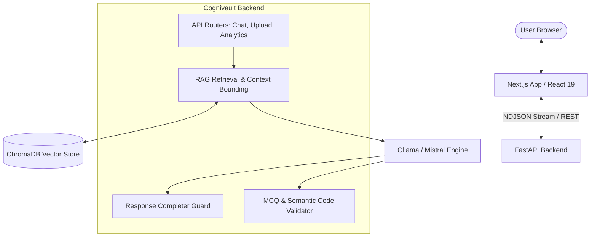

# Cognivault

**Cognivault** is an intelligent, document-grounded AI assistant and Retrieval-Augmented Generation (RAG) platform. It allows users to upload documents (such as textbooks, academic papers, and technical guides) and interact with them using strict semantic grounding, verified question generation, and accurate code evaluation.

---

## Key Features

- **Strict Document Grounding**: Semantic vector retrieval powered by ChromaDB and LangChain, ensuring answers are strictly derived from verified document chunks with explicit refusal boundaries for unsupported or out-of-scope queries.
- **Document Isolation**: Multi-tenant document ID filtering guarantees queries only retrieve context from the selected document without cross-document leakage.
- **Advanced MCQ Generation & Semantic Validation**:
  - Code-dependent snippet verification (e.g., verifying Java loop outputs, multidimensional arrays, and String immutability).
  - Explanation fallacy rejection and technical accuracy enforcement (e.g., proper interface implementation semantics).
  - Inheritance hierarchy grounding against source documents.
- **Robust Streaming & Completion Pipeline**:
  - Real-time NDJSON token streaming with client-side buffer management.
  - Bounded response continuation for mid-sentence truncation recovery.
  - Dynamic predictive token budgets and hard execution timeouts.
- **Modern Next.js Frontend**: Responsive, dark-themed UI built with Next.js 16, React 19, and Tailwind CSS.

---

## Architecture Overview



---

## Tech Stack

- **Backend**: Python 3.11+, FastAPI, Uvicorn, Pydantic v2
- **RAG & NLP**: LangChain, ChromaDB, HuggingFace Sentence Transformers (`all-MiniLM-L6-v2`)
- **LLM Engine**: Ollama (`mistral:latest`)
- **Document Processing**: PyMuPDF (`fitz`), PyPDF, Tesseract OCR
- **Frontend**: Next.js 16 (App Router), React 19, TypeScript, Tailwind CSS, Lucide React, React Markdown

---

## Getting Started

### Prerequisites

1. **Python 3.11+** installed.
2. **Node.js 18+** and `npm` installed.
3. **Ollama** installed and running:
   ```bash
   ollama pull mistral:latest
   ollama serve
   ```

### 1. Backend Setup

```bash
# Navigate to backend directory
cd backend

# Create and activate virtual environment
python -m venv venv
# On Windows:
.\venv\Scripts\activate
# On Linux/macOS:
source venv/bin/activate

# Install dependencies
pip install -r requirements.txt

# Start backend server
uvicorn app.main:app --host 127.0.0.1 --port 8000 --reload
```

The API documentation will be available at `http://127.0.0.1:8000/docs`.

### 2. Frontend Setup

```bash
# Navigate to frontend directory
cd frontend

# Install dependencies
npm install

# Start development server
npm run dev
```

Open `http://localhost:3000` in your browser.

---

## Running Regression Tests

Cognivault includes a comprehensive 17-test regression audit suite verifying document isolation, grounded refusal guards, Java code output semantics, and MCQ validation rules:

```bash
cd backend
python -u test_regression_audit.py
```

---

## License

MIT License.
